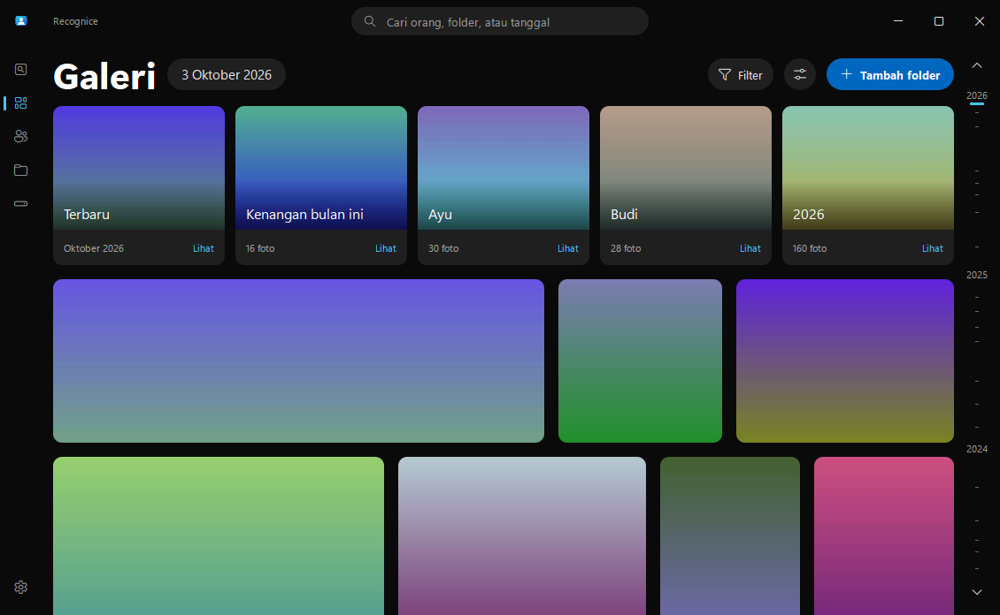
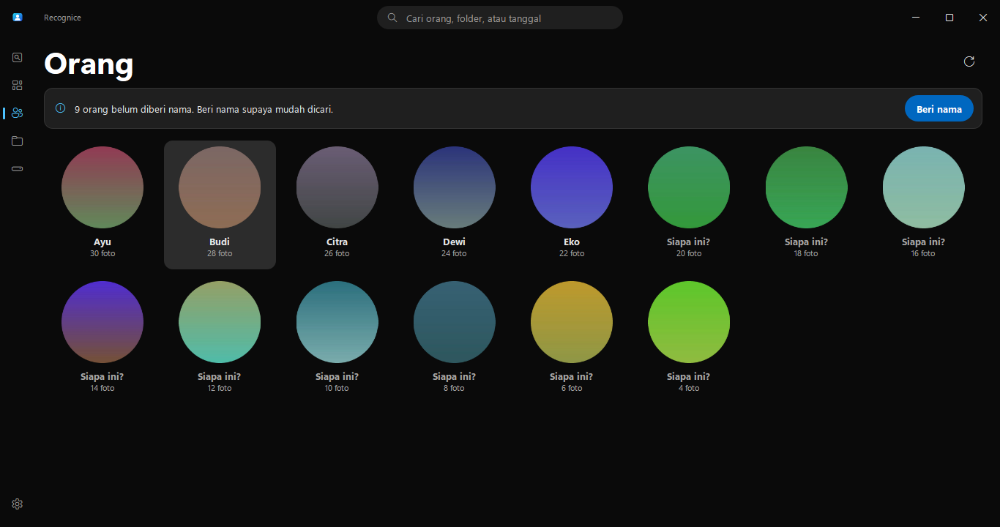
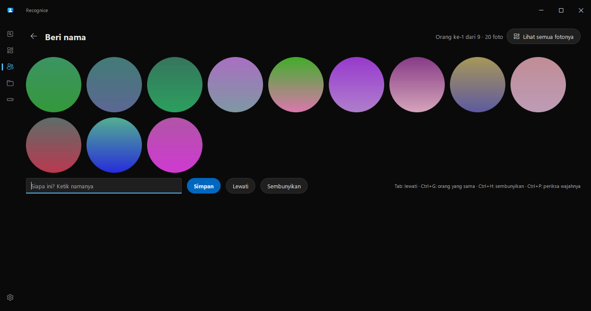
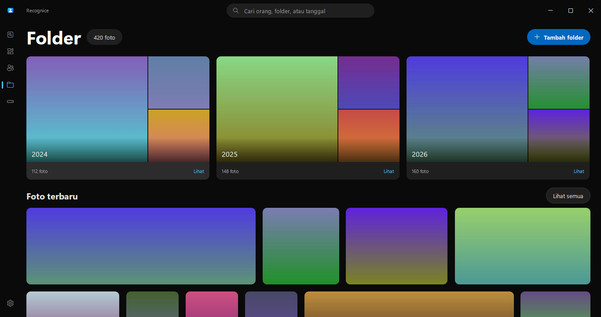
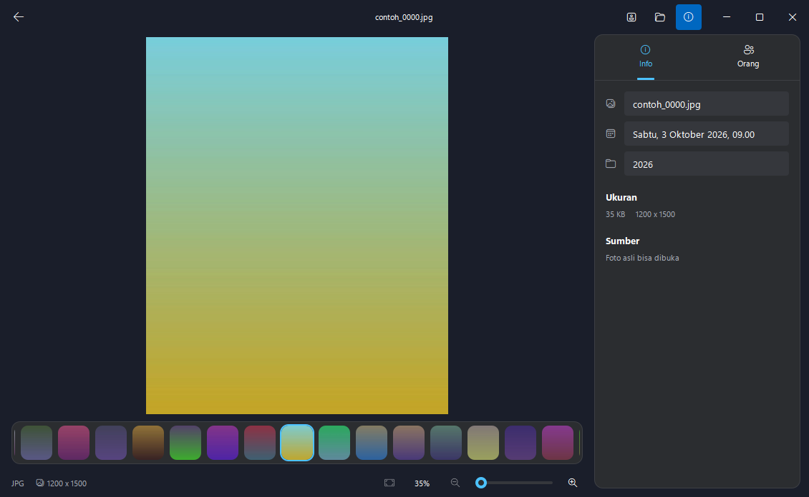

<h1 align="center">Recognice</h1>

<p align="center">
  <b>Find anyone in your photo library in seconds. Fully offline.</b>
</p>

<p align="center">
  
  
  
  
</p>

<p align="center">
  
</p>

Recognice turns tens of thousands of family photos, scattered across folders and drives, into one fast, beautiful gallery. It detects every face, groups the same person together, and lets you name them once. From then on, every photo of that person, from any year, is one click away.

No account. No cloud. Your photos and face data never leave your machine, and your original files are never touched.

## Features

- **Gallery**: justified photo wall, jump to any year, quick filters, and "on this day" memories
- **People**: faces are grouped automatically. Name, merge, or hide them in a few keystrokes
- **Search by photo**: drop in one picture and find every other photo of that person
- **Folders**: browse your library exactly as it's laid out on disk
- **Move-proof**: moved a folder or changed a drive letter? Recognice finds your photos again without rescanning
- **Runs in the background**: pause anytime; it stops automatically when your laptop is on battery
- **Archive-safe**: originals are read-only, and export always copies
- **Fast on modest hardware**: runs on Intel integrated graphics via OpenVINO, about 3x faster than CPU

<table>
  <tr>
    <td></td>
    <td></td>
  </tr>
  <tr>
    <td></td>
    <td></td>
  </tr>
</table>

<sub>Screenshots use synthetic sample images. The interface is in Indonesian.</sub>

## Getting started

Requires Windows 10/11 (64-bit) and Python 3.14.

```bash
git clone https://github.com/halimxn/recognice.git
cd recognice
python -m venv .venv
.venv\Scripts\python.exe -m pip install -r requirements.txt
```

Download `buffalo_l.zip` from the [InsightFace model zoo](https://github.com/deepinsight/insightface/tree/master/model_zoo) and copy `det_10g.onnx` and `w600k_r50.onnx` into `models/buffalo_l/`.

```bash
.venv\Scripts\python.exe app\main.py
```

Click **Tambah folder** (Add folder) and pick your photo folder. You can browse right away while faces are recognized in the background.

To get a portable build that runs without Python, run `Kemas.cmd`. The output goes to `dist\Recognice\`.

## How it works

| Component | Stack |
|---|---|
| UI | PySide6 + Qt Quick (QML) |
| Face detection | SCRFD-10G, then a per-face second pass for precise landmarks |
| Face embedding | ArcFace R50 (WebFace600K), 512-d |
| Inference | OpenVINO on Intel GPU, falling back to ONNX Runtime on CPU |
| Storage | A single SQLite file next to the app |

Every performance claim is backed by measurements in [`dev/bench/HASIL.md`](dev/bench/HASIL.md). For example, a photo with faces takes about 0.4 s on an Intel HD 520, versus about 1.4 s on the CPU.

```
app/core/       scanner, face pipeline, clustering, search (no Qt)
app/ui/qml/     interface
app/ui/bridge/  Python ↔ QML bridge
dev/            tests, benchmarks, evaluation
```

Run the tests:

```bash
.venv\Scripts\python.exe -m pytest dev\uji -q
```

## Notes

- InsightFace model weights are licensed for non-commercial use only, so they are not included in this repository.
- Similarity scores are not confidence percentages. Review the grouped faces before you name them.
